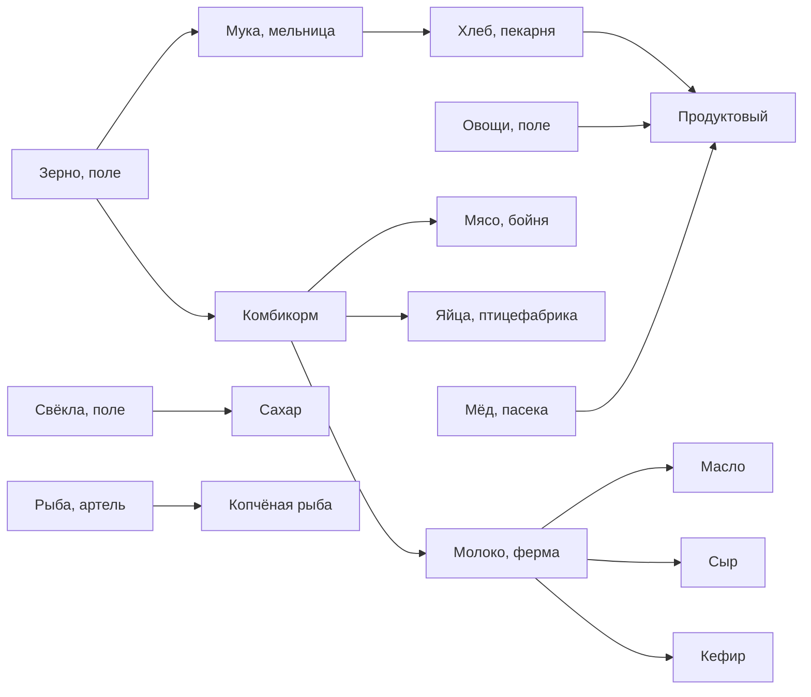
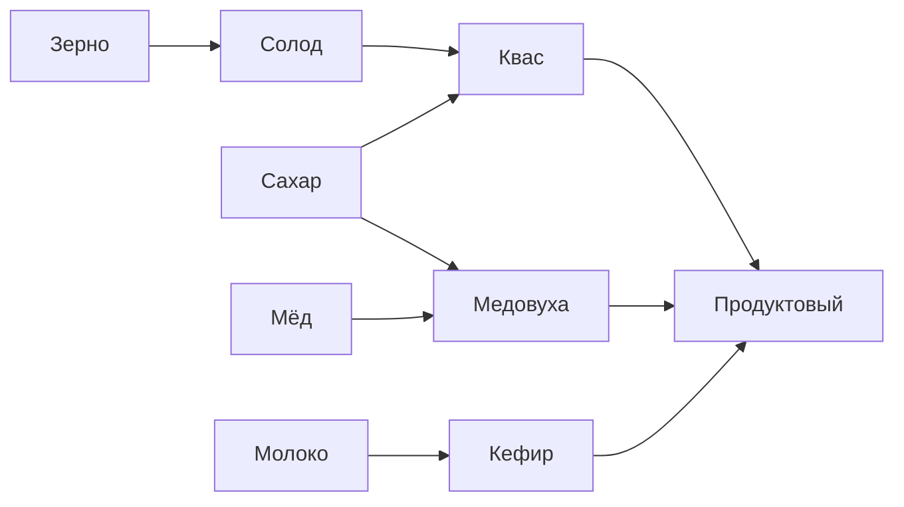
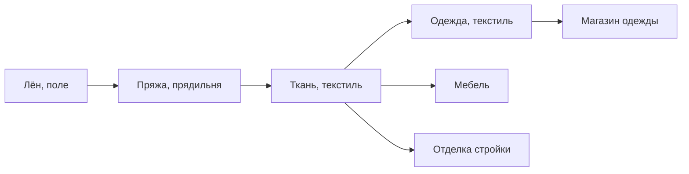
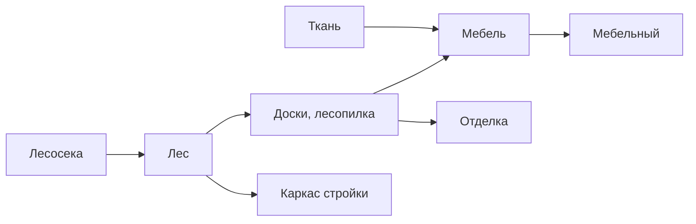
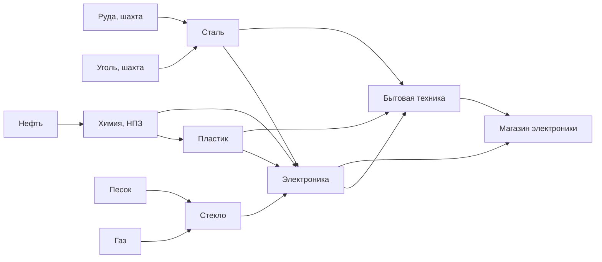
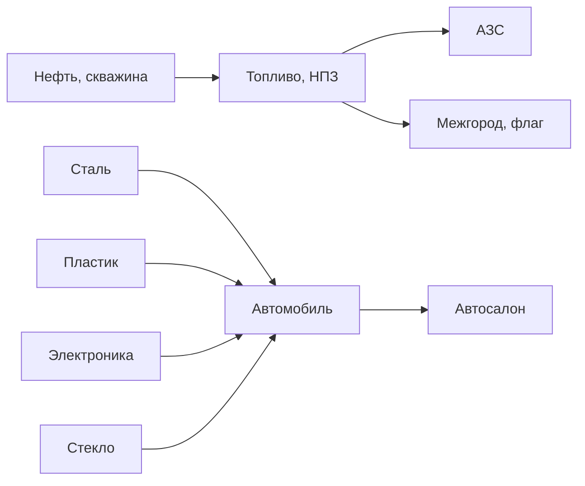
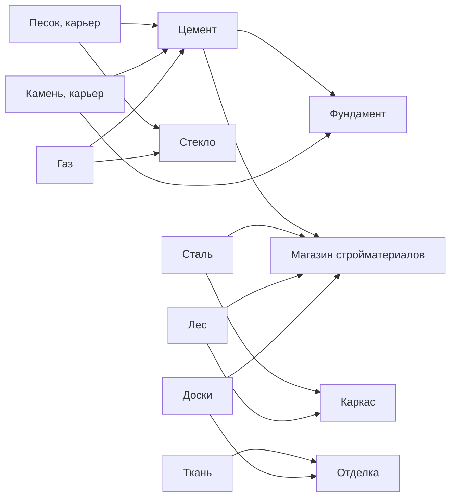

# GDD 18. Производственные цепочки

**Статус:** предложение, `balance: draft`. Каталог сервера не заменён. Данные лежат в `tools/sim/data/chains_proposed/`. Проверка: `python tools/validate_chains_proposal.py`.

Решение владельца, из которого сделан этот документ: в бете сеть должна быть полной, как в Capitalism Lab, а числа настраиваются после того, как все звенья есть в игре. Здесь сеть и первичные целые числа. Точный баланс не делался.

## Допущения

1. Файлы предложения — полный будущий каталог, а не патч. `server/data` в этой ветке не менялся.
2. Все старые id товаров, зданий и рецептов сохранены. Новый товар, здание и рецепт получают новый id.
3. Менять вход и выход старого рецепта можно. Такое место помечено словом «Меняется» в `description`. Список ниже.
4. Цепочка хлеба M1 не тронута: поле 100 зерна, мельница 100→80 муки, пекарня 80→100 хлеба, хлеб в продуктовом и супермаркете.
5. Объём `refinery_fuel` (40 нефти → 300 топлива) не менялся, хотя по эталонным ценам выход дешевле входа. Это старый черновик, его чинит отдельный проход баланса.
6. Цена леса 1200 ₽/кг тоже старая. Лесосека из-за неё даёт большой эталонный выход. Цену не подкручивал.
7. Молочная ферма и бойня теперь едят комбикорм. Так у зерна появляется второй потребитель, а у молока и мяса появляется ступень. Если нужен нулевой риск для старых ферм, комбикорм можно оставить только птицефабрике. Рекомендация: оставить как в предложении.
8. Топливо становится потребительским (`consumer: true`, спрос 1). Его продаёт АЗС. Логистика тратит его отдельно, флаг по умолчанию выключен.
9. Новая еда и напитки имеют спрос 2, как старые потребительские товары. Мебель, техника, автомобиль и топливо имеют спрос 1. Это не расчёт корзины.
10. Стройматериалы в магазине стройматериалов не становятся потребительскими. Так же, как ткань уже лежит в магазине одежды, но жители её сами не «едят». Спрос жителей включается только при `consumer: true`.
11. Ввод здания материалов не ест. Только деньги, как сейчас.
12. Склад, офис и жильё рецептов не получают. Это записанные исключения, не дыры.
13. Заводы не жгут топливо в рецепте. Иначе один и тот же литр посчитается дважды: в цехе и в рейсе. Открытый вопрос ниже.
14. Переработки отходов нет. Граф рецептов ациклический.
15. Новых полей в схеме каталога нет. Сток стройки, топлива и газа лежит в `sinks.json`, не в `server/data/schema.json`.
16. Имена по-русски, id латиницей, как в текущем каталоге. Доски названы `boards`, потому что именно этот id уже был назван дырой в `docs/catalog.md`.
17. Напитки региона: квас и медовуха, не пиво. Лён, мёд, нефть, лес, свёкла, речная рыба, белорецкая сталь.
18. Электроэнергию отдельным товаром не вводил. Газ и уголь уходят в стекло, цемент и сталь.
19. Ассортимент продуктового и супермаркета только расширен. Электронику из них не убирал: клиент уже умеет её там продавать.
20. Все числа целые. Деление вниз. Флаги стоков по умолчанию 0, пока директор их не включит.

## Аудит текущего каталога

Снято с `server/data` на `main` (25 товаров, 20 зданий, 17 рецептов). «Замкнут» значит: есть рецепт-источник и путь до покупателя (розница или следующий рецепт, который сам доходит до розницы).

### Товары

| id | Тип | Источник | Кто берёт | Розница | Замкнут |
|---|---|---|---|---|---|
| honey | сырьё, потребительский | `apiary_honey` | магазин | да | да |
| grain | сырьё | `field_grain` | мука | нет | да, через хлеб |
| flour | промежуточный | `mill_flour` | хлеб | нет | да |
| bread | потребительский | `bakery_bread` | магазин | да | да |
| milk | сырьё, потребительский | `dairy_milk` | магазин | да | да, без переработки |
| meat | сырьё, потребительский | `slaughter_meat` | магазин | да | да, без входа |
| vegetables | сырьё, потребительский | `field_vegetables` | магазин | да | да |
| oil | сырьё | `oil_well_oil` | топливо | нет | нет: топливо никто не берёт |
| gas | сырьё | нет | нет | нет | нет |
| sand | строительный | `quarry_sand` | нет | нет | нет |
| wood | строительный | `sawmill_wood` без входа | нет | нет | нет |
| stone | строительный | `quarry_stone` | цемент | нет | нет: цемент никто не берёт |
| cement | строительный | `cement_plant_cement` | нет | нет | нет |
| steel | строительный | `steel_mill_steel` без входа | нет | нет | нет |
| clothes | потребительский | `textile_clothes` | магазин | да | да |
| fabric | промежуточный | `textile_fabric` без входа | одежда и магазин одежды | да, как ткань | до покупателя да, сырья нет |
| electronics | потребительский | `electronics_plant_electronics` без входа | магазин | да | до покупателя да, сырья нет |
| fuel | топливо | `refinery_fuel` | нет | нет | нет |
| sugar | потребительский | нет | магазин | да | нет источника |
| butter | потребительский | нет | магазин | да | нет источника |
| cheese | потребительский | нет | магазин | да | нет источника |
| eggs | сырьё, потребительский | нет | магазин | да | нет источника |
| fish | сырьё, потребительский | нет | магазин | да | нет источника |
| plastic | промежуточный | нет | нет | нет | нет |
| chemicals | промежуточный | нет | нет | нет | нет |

### Здания

| id | Роль | Рецепты сейчас | Дыра |
|---|---|---|---|
| field | ферма | зерно, овощи | нет свёклы и льна |
| apiary | ферма | мёд | дальше мёд только в магазин |
| mill | завод | мука | — |
| bakery | завод | хлеб | — |
| oil_well | добыча | нефть | дальше цепочка рвётся на топливе |
| refinery | завод | топливо | нет химии, топливо без спроса |
| dairy | ферма | молоко без входа | нет масла, сыра, кефира |
| slaughter | завод | мясо без входа | — |
| quarry | добыча | песок, камень | песок никому не нужен |
| sawmill | завод | лес из ничего | текст здания про доски, товара досок нет |
| cement_plant | завод | цемент из камня | цемент никто не берёт |
| steel_mill | завод | сталь из ничего | сталь никто не берёт |
| textile | завод | ткань из ничего, одежда | нет волокна |
| electronics_plant | завод | электроника из ничего | нет комплектующих |
| warehouse | склад | нет | не производитель, так и должно быть |
| grocery_store | розница | 12 товаров, среди них товары без источника | — |
| supermarket | розница | те же 12 | — |
| clothing_store | розница | одежда, ткань | — |
| office | офис | нет | не производитель |
| housing | жильё | нет | не производитель |

### Дыры списком

Нет источника: газ, сахар, масло, сыр, яйца, рыба, пластик, химия.

Источник есть, потребителя нет: песок, лес, цемент, сталь, топливо. Камень и нефть упираются в эти тупики.

Источник есть, но это «из воздуха», хотя текст обещает сырьё: лесопилка, сталь, ткань, электроника, молоко, мясо.

Розница уже ждёт товар, которого никто не делает: сахар, масло, сыр, яйца, рыба.

Стройка списывает только деньги (`server/enterprises/core.py`, доли 300/400/200/100 ‰). Материалы не списываются. Межгород берёт деньги за километр (`server/supply/core.py`, `_travel`), топливо не списывает.

## Правила сети

У товара может быть несколько потребителей. У рецепта может быть несколько входов и один или несколько выходов. У здания может быть несколько рецептов, игрок выбирает один режим. Это уже так у поля, карьера и текстиля.

Источник — рецепт, в чьём `outputs` есть товар. Потребитель — другой рецепт, розница (`allowed_goods`) или сток из `sinks.json` (стройка, логистика, городской газ).

Исключений среди товаров нет. Исключения среди зданий, с причиной:

| id | Почему без рецепта |
|---|---|
| warehouse | Склад хранит, не выпускает. |
| office | Штаб, не выпуск. |
| housing | Население, не товар. |

Проверка не принимает каталог, если исключение без текста, если у товара нет источника или потребителя, если есть цикл, если потребительский товар не лежит ни в одном магазине, если число не целое или размер не положительный.

## Цепочки

Объёмы — штуки за игровые сутки при полной загрузке. Цены не повторяю, они в [CHAINS_DATA.md](../proposals/CHAINS_DATA.md).

### 1. Еда



| Ступень | Вход | Рецепт | Выход | Здание |
|---|---|---|---|---|
| зерно | нет | `field_grain` | зерно 100 | field |
| мука | зерно 100 | `mill_flour` | мука 80 | mill |
| хлеб | мука 80 | `bakery_bread` | хлеб 100 | bakery |
| комбикорм | зерно 80 | `feed_plant_feed` | комбикорм 70 | feed_plant |
| молоко | комбикорм 30 | `dairy_milk` **меняется** | молоко 90 | dairy |
| мясо | комбикорм 40 | `slaughter_meat` **меняется** | мясо 35 | slaughter |
| яйца | комбикорм 20 | `poultry_eggs` | яйца 80 | poultry_farm |
| масло | молоко 50 | `creamery_butter` | масло 18 | creamery |
| сыр | молоко 50 | `creamery_cheese` | сыр 12 | creamery |
| кефир | молоко 40 | `creamery_kefir` | кефир 50 | creamery |
| свёкла | нет | `field_sugar_beet` | свёкла 120 | field |
| сахар | свёкла 100 | `sugar_plant_sugar` | сахар 40 | sugar_plant |
| овощи | нет | `field_vegetables` | овощи 80 | field |
| мёд | нет | `apiary_honey` | мёд 12 | apiary |
| рыба | нет | `fishery_fish` | рыба 25 | fishery |
| копчёная рыба | рыба 20 | `smokehouse_smoked` | копчёная 16 | smokehouse |

Глубина до сыра: зерно → комбикорм → молоко → сыр, четыре ступени. Хлеб остаётся тремя. Овощи и мёд по-прежнему с грядки и пасеки сразу в магазин: для них переработка не нужна, мёд дополнительно идёт в медовуху.

### 2. Напитки



| Ступень | Вход | Рецепт | Выход | Здание |
|---|---|---|---|---|
| солод | зерно 50 | `malthouse_malt` | солод 40 | malthouse |
| квас | солод 30, сахар 10 | `beverage_kvass` | квас 80 | beverage_plant |
| медовуха | мёд 8, сахар 6 | `beverage_mead` | медовуха 20 | beverage_plant |
| кефир | молоко 40 | `creamery_kefir` | кефир 50 | creamery |

Квас: зерно → солод → квас, три ступени, плюс сахар со второй цепочки.

### 3. Одежда



| Ступень | Вход | Рецепт | Выход | Здание |
|---|---|---|---|---|
| лён | нет | `field_flax` | лён 70 | field |
| пряжа | лён 60 | `spinning_yarn` | пряжа 45 | spinning_mill |
| ткань | пряжа 50 | `textile_fabric` **меняется** | ткань 65 | textile |
| одежда | ткань 40 | `textile_clothes` | одежда 25 | textile |

Четыре ступени. Ткань по-прежнему можно положить в магазин одежды.

### 4. Мебель и дом



| Ступень | Вход | Рецепт | Выход | Здание |
|---|---|---|---|---|
| лес | нет | `logging_wood` | лес 70 | logging_camp |
| доски | лес 70 | `sawmill_wood` **меняется** | доски 50 | sawmill |
| мебель | доски 12, ткань 8 | `furniture_workshop_furniture` | мебель 6 | furniture_workshop |

Id рецепта лесопилки оставлен `sawmill_wood`, выход сменён с леса на доски. Раньше лесопилка сама «добывала» лес, хотя текст здания говорит про доски.

### 5. Электроника и бытовая техника



| Ступень | Вход | Рецепт | Выход | Здание |
|---|---|---|---|---|
| руда | нет | `mine_iron` | руда 90 | mine |
| уголь | нет | `mine_coal` | уголь 110 | mine |
| сталь | руда 80, уголь 40 | `steel_mill_steel` **меняется** | сталь 35 | steel_mill |
| химия | нефть 2 | `refinery_chemicals` | химия 40 | refinery |
| пластик | химия 30 | `polymer_plastic` | пластик 35 | polymer_plant |
| стекло | песок 80, газ 30 | `glass_plant_glass` | стекло 50 | glass_plant |
| электроника | сталь 8, пластик 10, химия 6, стекло 8 | `electronics_plant_electronics` **меняется** | электроника 12 | electronics_plant |
| техника | сталь 6, пластик 8, электроника 2 | `appliance_plant_appliances` | техника 4 | appliance_plant |

От нефти до электроники четыре ступени: нефть → химия → пластик → электроника. От руды до техники: руда → сталь → электроника → техника.

Нефть на химию взята маленькой (2 бочки), потому что бочка в каталоге стоит 3500, а килограмм химии 260. Иначе ступень была бы убыточной по эталону. Объём топлива не трогал.

### 6. Топливо и транспорт



| Ступень | Вход | Рецепт | Выход | Здание |
|---|---|---|---|---|
| нефть | нет | `oil_well_oil` | нефть 40 | oil_well |
| топливо | нефть 40 | `refinery_fuel` | топливо 300 | refinery |
| газ | нет | `gas_well_gas` | газ 200 | gas_well |
| автомобиль | сталь 20, пластик 12, электроника 2, стекло 8 | `auto_plant_car` | автомобиль 1 | auto_plant |

Топливо не входит в рецепт автомобиля и не входит в рецепты заводов. Его берут жители на АЗС и, когда флаг включён, межгородские рейсы.

### 7. Строительные материалы



| Ступень | Вход | Рецепт | Выход | Здание |
|---|---|---|---|---|
| песок | нет | `quarry_sand` | песок 150 | quarry |
| камень | нет | `quarry_stone` | камень 100 | quarry |
| цемент | камень 70, песок 40, газ 20 | `cement_plant_cement` **меняется** | цемент 55 | cement_plant |

Песок закрыт цементом и стеклом. Камень закрыт цементом и фундаментом. Цемент, сталь, лес, доски и ткань закрыты стройкой. Магазин стройматериалов продаёт песок, камень, цемент, лес, доски, сталь и стекло другим игрокам, не жителям.

## Сток стройматериалов

Деньги стадий не меняются. `stage_costs` в `server/enterprises/core.py` по-прежнему делит `build_cost` на 300, 400, 200 и 100 промилле. Четыре имени стадий те же: `foundation`, `frame`, `finishing`, `commissioning`.

Новый флаг `build_materials_required`, по умолчанию **0**. При 0 игра как сейчас: только деньги. При 1 стадия начинается только когда есть и деньги, и материалы.

Норма на одну клетку следа здания (`width * height`), целые:

| Стадия | На клетку |
|---|---|
| фундамент | цемент 20, камень 30 |
| каркас | сталь 8, лес 10 |
| отделка | ткань 4, доски 12 |
| ввод | ничего |

Пример для поля 2×2, четыре клетки: фундамент 80 цемента и 120 камня, каркас 32 стали и 40 леса, отделка 16 ткани и 48 досок. Ввод пустой. Деньги те же 39000, что и сейчас у поля.

Как списывать, минимально:

1. У стройки есть склад материалов, тот же `inventory`, что у предприятия. Игрок заводит обычные связи поставки.
2. Перед входом в стадию сервер считает норму. Если денег не хватает или материала не хватает, стадия не начинается и деньги не списываются. Материалы тоже не списываются. Ожидание пишется как сейчас, в `enterprise_build_waits`.
3. Когда хватает обоих, в одной транзакции: списать долю денег прежним `request_id` `enterprise:build:<id>:<stage>` и уменьшить склад на норму. Повтор той же стадии невозможен из-за уже существующей строки оплаты.
4. Снос не возвращает материалы в этой версии. Денежный возврат 200 ‰ (`server/enterprises/api.py`) не трогать. Вернуть материалы можно отдельным заданием, не сейчас.
5. Внешний рынок уже умеет привозить недостающее. Автозакупку материалов не делать: иначе стройка не создаст спрос на цемент.

Модули: `server/enterprises/core.py` (проверка и списание рядом с `_pay_build_stage`), `server/enterprises/api.py` (показать норму и нехватку рядом с `next_payment`), чтение флага из настроек игры там же, где лежат остальные draft-флаги. Каталог подхватывается заменой JSON, отдельный код рецептов стройки не нужен: нормы в `sinks.json`, их надо положить в данные, которые читает сервер, когда флаг включат. Клиент: экран стройки `client/screens/build.gd` и карточка предприятия `client/screens/enterprises.gd`, строка «не хватает цемента».

## Сток топлива

Флаг `logistics_fuel_required`, по умолчанию **0**. Денежный фрахт не заменяется. Формула денег в `_travel` остаётся: `distance_meters * quantity * per_km_unit // 1000`.

При 1 межгород дополнительно ест топливо:

```
liters = distance_meters * quantity // 100000
если рейс межгород и quantity > 0 и liters == 0, liters = 1
если город один и тот же, liters = 0
```

Пример: 85 км и 100 единиц → 85000 * 100 // 100000 = 85 литров. НПЗ даёт 300 литров в сутки. Порядок черновой.

Откуда литры. Парка грузовиков ещё нет, GDD 05 относит его к M3. Поэтому второй флаг `logistics_fuel_autobuy`, рекомендуемое значение **1**, когда топливный флаг включён: литры покупаются у `system:market` по `reference_price` топлива, проводка рядом с фрахтом, `request_id` рейса с суффиксом `:fuel`. Склад топлива у покупателя в первой версии не обязателен. Когда появится парк, автозакупку можно выключить и забирать литры со склада.

Внутри города топливо не тратится, как и деньги за километр.

Модули: `server/supply/core.py` (`_travel`, `_ship`, место, где уже считается `freight`). Расстояние только читается из `server/world/core.py`, мир не менять. Клиент: `client/screens/supply.gd`, строка «топливо рейса» рядом с ценой перевозки. Розница топлива — обычный магазин `fuel_station`, отдельных правил розницы не нужно.

## Прочие стоки

Флаг `city_gas_utility`, по умолчанию **0**. При 1 город за сутки покупает газ:

```
m3 = population // 10000
если population > 0 и m3 == 0, m3 = 1
```

Уфа 1 150 000 → 115 м³. Скважина даёт 200. Город закрывается одной скважиной, остаток может уйти в стекло и цемент. Покупка со счёта `system:market` на продавца газа по цене клиринга или по эталону, если клиринга ещё нет. Это не розница жителей.

Модуль: суточный тик города. Сейчас ближе всего `server/market` и обработчик спроса. Отдельного модуля «коммуналка» нет, директору лучше повесить на тик после рынка, не внутрь розницы. Клиентский экран не обязателен в первой версии: достаточно строки в отчёте города.

Других стоков нет. Заводы топливо в рецепте не жгут.

## Новые id

Товары: `sugar_beet`, `feed`, `flax`, `yarn`, `boards`, `furniture`, `iron_ore`, `coal`, `glass`, `appliances`, `car`, `malt`, `kvass`, `kefir`, `mead`, `smoked_fish`.

Здания: `logging_camp`, `gas_well`, `mine`, `feed_plant`, `sugar_plant`, `creamery`, `poultry_farm`, `fishery`, `smokehouse`, `spinning_mill`, `malthouse`, `beverage_plant`, `glass_plant`, `polymer_plant`, `furniture_workshop`, `appliance_plant`, `auto_plant`, `furniture_store`, `electronics_store`, `fuel_station`, `car_dealer`, `hardware_store`.

Рецепты: `field_sugar_beet`, `field_flax`, `logging_wood`, `gas_well_gas`, `mine_iron`, `mine_coal`, `feed_plant_feed`, `sugar_plant_sugar`, `creamery_butter`, `creamery_cheese`, `creamery_kefir`, `poultry_eggs`, `fishery_fish`, `smokehouse_smoked`, `spinning_yarn`, `malthouse_malt`, `beverage_kvass`, `beverage_mead`, `glass_plant_glass`, `refinery_chemicals`, `polymer_plastic`, `furniture_workshop_furniture`, `appliance_plant_appliances`, `auto_plant_car`.

## Изменённые id

Рецепты, id тот же:

| id | Было | Стало |
|---|---|---|
| `dairy_milk` | без входа → молоко 90 | комбикорм 30 → молоко 90 |
| `slaughter_meat` | без входа → мясо 35 | комбикорм 40 → мясо 35 |
| `sawmill_wood` | без входа → лес 70 | лес 70 → доски 50 |
| `cement_plant_cement` | камень 70 → цемент 55 | камень 70, песок 40, газ 20 → цемент 55 |
| `steel_mill_steel` | без входа → сталь 35 | руда 80, уголь 40 → сталь 35 |
| `textile_fabric` | без входа → ткань 65 | пряжа 50 → ткань 65 |
| `electronics_plant_electronics` | без входа → электроника 12 | сталь 8, пластик 10, химия 6, стекло 8 → электроника 12 |

Товар `fuel`: `consumer` стал true, `base_demand_per_capita` стал 1. Цена 70 не менялась.

Здания `grocery_store` и `supermarket`: в `allowed_goods` добавлены `kefir`, `kvass`, `mead`, `smoked_fish`. Старые id не удалялись.

Остальные старые записи совпадают с `server/data` как объекты JSON. Это проверяет тест. Файл целиком перезаписан предложением, поэтому байты файла другие, а поля нетронутых id те же.

## Совместимость с клиентом и сервером

Сервер при старте валидирует каталог (`server/catalog/__init__.py`): схема, сумма весов 100, циклы, производитель каждого входа, рецепт у каждого производственного здания, хлеб M1. Предложение проходит те же правила. Отдельная схема не нужна: `tools/validate_chains_proposal.py` гоняет `server/data/schema.json` по предложению и не пишет в `server/data`.

Пока JSON сервера не заменён, игра не видит новые id. Замена — одно задание директора, не эта ветка. После замены `GET /catalog` отдаст новый снимок и другой SHA. Клиент каталог не копирует, имена придут с сервера.

Жёстко зашитые места, которые надо проверить при замене, а не раньше:

- `client/screens/enterprises.gd` считает розницей роль `retail` или список `grocery_store`, `supermarket`, `clothing_store`, `kiosk`. Роль уже покрывает новые магазины. `kiosk` в каталоге нет и сейчас: это старый хвост, при правке экрана его лучше убрать, не добавлять.
- Иконок на товар нет. Экран показывает `name` из каталога.
- Тексты `docs/content/products.ru.md` и `buildings.ru.md` в этой ветке не дополнялись. Их надо дописать в том задании, которое копирует JSON в `server/data`.
- `tools/validate_enterprises.py` проверяет только хлебные объёмы сервера. Они не менялись. Симулятор M1 читает `server/data`, не предложение, золотые файлы не сдвинутся.
- Рецепт по-прежнему один на предприятие в рантайме. Несколько рецептов у здания уже поддержаны каталогом. Новый код выбора режима не требуется, если экран уже умеет список рецептов здания.

Флаги стоков не должны менять поведение при значении 0. Приёмка M1 (поле, мельница, пекарня, магазин, 10 дней) обязана проходить с флагами 0 даже после замены каталога.

## Критерии приёмки

Предложение, уже в этой ветке:

- `python tools/validate_chains_proposal.py` печатает OK.
- `python -m unittest tools.tests.test_chains_proposal` зелёный.
- `python tools/validate_catalog.py` и `python tools/validate_enterprises.py` зелёные на нетронутом `server/data`.
- 41 товар, 42 здания, 41 рецепт. Исключений товаров 0. Исключения зданий: склад, офис, жильё.
- Нет товара без источника и без потребителя. Нет цикла. Каждый `consumer: true` есть хотя бы в одном магазине.
- Все числа целые, размеры положительные.

После реализации директором, не в этой ветке:

- Каталог сервера заменён предложением, старые id на месте, SHA каталога сменился.
- При флагах 0 стройка и логистика ведут себя как до замены. Тест десяти дней хлеба зелёный.
- При `build_materials_required = 1` поле 2×2 не выходит из фундамента, пока на складе стройки нет 80 цемента и 120 камня. Деньги фундамента не списываются раньше материалов. Повторный тик не списывает долю второй раз.
- При `logistics_fuel_required = 1` рейс внутри города ест 0 литров. Рейс 85000 м на 100 единиц ест 85 литров. Денежный фрахт на месте.
- АЗС продаёт топливо, автосалон продаёт автомобиль, мебельный продаёт мебель, магазин электроники продаёт электронику и технику.
- Масло, сыр, сахар, яйца, рыба имеют рецепт и лежат в продуктовом.

## Открытые вопросы

1. **Включать стоки сразу с заменой каталога?** Рекомендация: нет. Сначала заменить JSON при флагах 0, прогнать M1, потом включать флаги по одному.
2. **Автозакупка материалов стройки?** Рекомендация: нет. Стадия ждёт. Игрок везёт сам или через порт. Так цемент получает настоящий спрос.
3. **Автозакупка топлива рейса?** Рекомендация: да, флаг `logistics_fuel_autobuy = 1`, пока нет грузовиков. Иначе межгород встанет без склада топлива, которого в игре ещё нет.
4. **Откатить комбикорм у молока и мяса?** Рекомендация: не откатывать. Глубина цепочки важнее пустого входа. Хлеб от этого не зависит.
5. **Отдельное электричество?** Рекомендация: не в этой волне. Газ закрыт стеклом, цементом и городским стоком.
6. **Жители покупают цемент?** Рекомендация: нет. `consumer` у стройматериалов остаётся false. Магазин стройматериалов для игроков и для витрины специализации из GDD 03.
7. **Переименовать `sawmill_wood` в `sawmill_boards`?** Рекомендация: не переименовывать. Код id не зашит, но правило ветки — старые id не трогать. Выход уже доски.
8. **Чинить минус нефтепереработки (40 бочек → 300 литров при текущих ценах)?** Рекомендация: не в этом задании. Владелец сказал настраивать баланс после появления всех цепочек. Минус записан в CHAINS_DATA.
9. **Версия флага в админке.** Рекомендация: три целых флага в уже существующие draft-настройки, без новой таблицы.

## Задания на реализацию

Директор режет на исполнителей. Эта ветка ничего из списка не делает.

1. **Каталог.** Заменить `server/data/products.json`, `buildings.json`, `recipes.json` содержимым `tools/sim/data/chains_proposed/` после приёмки. `schema.json` не расширять. Прогнать `tools/validate_catalog.py`, `server/tests/test_catalog_v2.py` и хлебный сценарий. Зона: `server/data`, `server/catalog`.
2. **Тексты.** Дописать новые id в `docs/content/products.ru.md` и `docs/content/buildings.ru.md` в том же формате таблиц. Глоссарий не обязателен. Зона: `docs/content`.
3. **Стройка, деньги как были, плюс материалы.** Флаг `build_materials_required`. Нормы из `sinks.json`. Атомарно с оплатой стадии. При 0 поведение байт в байт прежнее. Зона: `server/enterprises/core.py`, `server/enterprises/api.py`, тест рядом с `server/tests/test_enterprises_stage_payments.py`.
4. **Клиент стройки.** Показать норму стадии и нехватку. Не списывать долю на клиенте, только отображать ответ сервера. Зона: `client/screens/build.gd`, `client/screens/enterprises.gd`.
5. **Топливо рейса.** Флаги `logistics_fuel_required` и `logistics_fuel_autobuy`. Формула литров выше. Деньги фрахта не менять. Зона: `server/supply/core.py`, тест поставки. Мир (`server/world`) только читать.
6. **Клиент поставки.** Строка литров рядом с ценой рейса. Зона: `client/screens/supply.gd`.
7. **Городской газ.** Флаг `city_gas_utility`, формула от населения, покупка через `system:market`. Зона: суточный тик, ближе всего `server/market`. Не смешивать с розничной корзиной.
8. **Розница новых товаров.** Отдельной формулы не писать. Новые магазины уже в каталоге: `furniture_store`, `electronics_store`, `fuel_station`, `car_dealer`, `hardware_store`. Проверить, что специализация режет `allowed_goods`. Убрать зашитый `kiosk`, если экран всё ещё перечисляет магазины вручную. Зона: `server/retail`, `client/screens/enterprises.gd`, `client/screens/store.gd`.
9. **Иконки.** Отдельных иконок товаров нет, новые не рисовать, пока нет набора на старые. Если набор появится, ключ — id товара. Зона: `client/assets` или `client/content`, только вместе с общим набором.
10. **Симулятор.** Не переписывать золото M1 при флагах 0. Отдельный сценарий цепочки «свёкла → сахар» и «лес → доски → мебель» добавить после замены каталога, не до. Зона: `tools/sim`.
11. **Баланс.** После того как цепочки в игре и флаги по очереди включены: цены леса и нефти, спрос 1 у автомобиля, нормы стройки. Не раньше. Зона: новое предложение баланса, не эта ветка.
